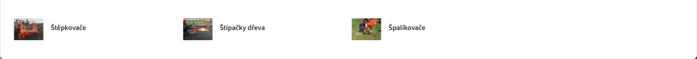
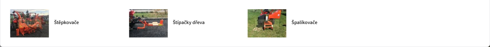
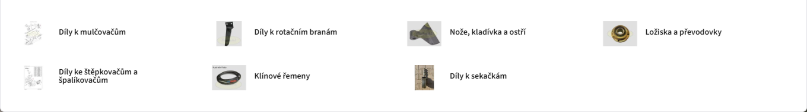
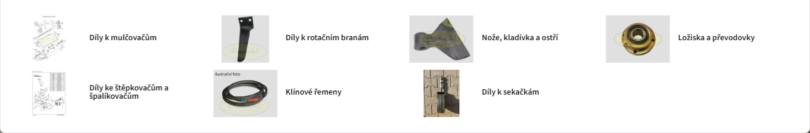

# Větší fotografie v rozbalovacím menu Adaminu

15. 11. 2026 · Lokální návrh pro hlavní navigaci e-shopu. Snímky ukazují skutečné kategorie a fotografie z veřejného Shoptetu. Návrh byl zapnutý pouze v testovacím prohlížeči.

## Lesní technika

Původní stav při šířce okna 1 440 px

Návrh při stejné šířce

## Náhradní díly ke strojům

Původní stav při šířce okna 1 440 px

Návrh při stejné šířce

## Měření a rozsah

Shoptet posílá deset zkontrolovaných fotografií jako náhledy 140 × 100 px. Adamin je na počítači zobrazuje v ploše přibližně 60 × 43 px. Návrh využívá větší část dostupného rozlišení a zachovává celý obrázek včetně poměru stran. Delší názvy se mohou zalomit.

| Šířka okna | Otevřená větev | Fotografie před → po | Vnitřní výška menu před → po |
| --- | --- | --- | --- |
| 1 440 px | Lesní technika, 3 položky | 60 × 43 → 112 × 80 px | 115 → 132 px |
| 1 440 px | Náhradní díly ke strojům, 7 položek | 60 × 43 → 112 × 80 px | 190 → 224 px |
| 1 024 px | Náhradní díly ke strojům, 7 položek | 60 × 43 → 88 × 63 px | 265 → 265 px |
| 390 px | Lesní technika, 3 položky | Mobilní textové menu | odkazy 42 px vysoké v obou případech |

V obou desktopových větvích se obsah vešel do sloupců. Na mobilu jsme otevřeli hlavní menu a klepli na Lesní techniku. Všechny tři odkazy byly čitelné a šířka stránky zůstala 390 px. [Mobilní snímek](../overeni/menu-mobil.png)

## Připravený styl

[CSS pro Adamin](../../../src/plachtovehaly/shoptet/menu-nahledy.css) cílí na fotografii podkategorie v hlavní navigaci od šířky 992 px. Využívá stávající obrázky a odkazy. Nasazení tohoto stylu do veřejného obchodu je popsáno níže. Smazáním tohoto bloku se vrátí původní zobrazení.

## Kontrola veřejné navigace 15. 11. 2026

Na počítači při šířce 1 440 px jsme otevřeli všechny čtyři rozbalovací větve se sortimentem firmy. U všech 17 podkategorií se načetla přiřazená produktová fotografie o rozměrech 140 × 100 px. Obrazový i textový odkaz každé položky vede na stejnou kategorii. Všech 17 cílů vrátilo HTTP 200 a nadpis odpovídal názvu v menu. Na mobilu při šířce 390 px jsme každou větev otevřeli z hlavního menu a ověřili její textové odkazy.

| Větev hlavního menu | Ověřené podkategorie |
| --- | --- |
| Zemědělská technika | [Mulčovače](https://plachtovehaly.agrodabaki.cz/mulcovace/), [Rotační brány](https://plachtovehaly.agrodabaki.cz/rotacni-brany/), [Transportní boxy](https://plachtovehaly.agrodabaki.cz/transportni-boxy/), [Paletizační vidle](https://plachtovehaly.agrodabaki.cz/paletizacni-vidle/), [Lžíce a díly k podkopům](https://plachtovehaly.agrodabaki.cz/lzice-a-dily-k-podkopum/), [Mulčovací sekačky](https://plachtovehaly.agrodabaki.cz/mulcovaci-sekacky/) |
| Náhradní díly ke strojům | [Díly k mulčovačům](https://plachtovehaly.agrodabaki.cz/dily-k-mulcovacum/), [Díly k rotačním branám](https://plachtovehaly.agrodabaki.cz/dily-k-rotacnim-branam/), [Nože, kladívka a ostří](https://plachtovehaly.agrodabaki.cz/noze--kladivka-a-ostri/), [Ložiska a převodovky](https://plachtovehaly.agrodabaki.cz/loziska-a-prevodovky/), [Díly ke štěpkovačům a špalíkovačům](https://plachtovehaly.agrodabaki.cz/dily-ke-stepkovacum-a-spalikovacum/), [Klínové řemeny](https://plachtovehaly.agrodabaki.cz/klinove-remeny/), [Díly k sekačkám](https://plachtovehaly.agrodabaki.cz/dily-k-sekackam/) |
| Lesní technika | [Štěpkovače](https://plachtovehaly.agrodabaki.cz/stepkovace/), [Štípačky dřeva](https://plachtovehaly.agrodabaki.cz/stipacky-dreva/), [Špalíkovače](https://plachtovehaly.agrodabaki.cz/spalikovace/) |
| Vybavení pro chov koní | [Údržba výběhů a jízdáren](https://plachtovehaly.agrodabaki.cz/udrzba-vybehu-a-jizdaren/) |

V nabídce Více jsou na počítači vidět také ukázkové větve Oblečení, Módní doplňky a Do domácnosti. Na mobilu jsou rozbalitelné a vedou do deseti ukázkových podkategorií. Položka Značky nabízí Columbia, Fila, Nike, Storm a Suunto. Všech patnáct odkazů je veřejně dostupných. Tyto položky patří do plánovaného úklidu kategorií a značek. U skutečného sortimentu nebylo potřeba doplňovat žádnou fotografii.

## Úklid veřejné nabídky 15. 11. 2026

Z katalogu byly odstraněny tři ukázkové větve Oblečení, Módní doplňky a Do domácnosti včetně jejich deseti podkategorií. V nabídce kategorií bylo vypnuto pět ukázkových značek Columbia, Fila, Nike, Storm a Suunto. Dva ukázkové snímky carouselu odkazovaly na Do domácnosti, proto byla u obou vypnuta viditelnost. Po kontrole úvodní stránky při šířkách 1440 a 390 px byly ověřeny čtyři rozbalovací větve a všech 17 odkazů na sortiment firmy.

Patička obsahuje nativní prvek Informace pro vás. Jeho odkazy se spravují ve Vzhled a obsah → Menu → Informace pro vás a umístění ve Vzhled a obsah → Šablony → Prvky. Kontakty i Obchodní podmínky byly viditelné na počítači a telefonu a obě stránky vrátily HTTP 200. [Patička na počítači](../overeni/paticka-uklid-1440.png) · [Patička v telefonu](../overeni/paticka-uklid-390.png)

## Nasazení větších fotografií 16. 11. 2026

Před změnou měla první fotografie v Zemědělské technice na počítači šířku 60 px. Do Vzhled a obsah → Editor → HTML kódy → Záhlaví jsme vložili [styl pro velikost fotografií](../../../src/plachtovehaly/shoptet/menu-nahledy.css) s identifikátorem `dabaki-menu-fotografie`. Po uložení jsme porovnali celé záhlaví se zamýšlenou úpravou.

Na veřejném e-shopu při šířce 1 440 px jsme otevřeli čtyři větve a naměřili u všech 17 fotografií šířku 112 px (výška 80 px). Při 1 024 px byly na hlavní liště dostupné Zemědělská a Lesní technika. Jejich devět obrázků mělo šířku 88 px (výška přibližně 63 px). Na telefonu při 390 px jsme otevřeli všechny čtyři větve a ověřili všech 17 textových položek s výškou odkazu alespoň 40 px. Při všech třech šířkách se obsah vešel do okna. Každý ze 17 cílových odkazů jsme otevřeli a ověřili HTTP 200 a odpovídající nadpis kategorie. [Široká obrazovka](../overeni/menu-nasazeno-1440.png) · [Menší obrazovka](../overeni/menu-nasazeno-1024.png) · [Telefon](../overeni/menu-nasazeno-390.png)
