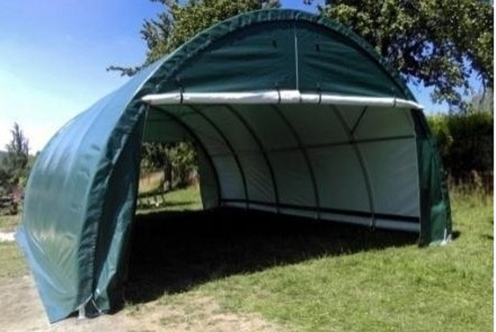
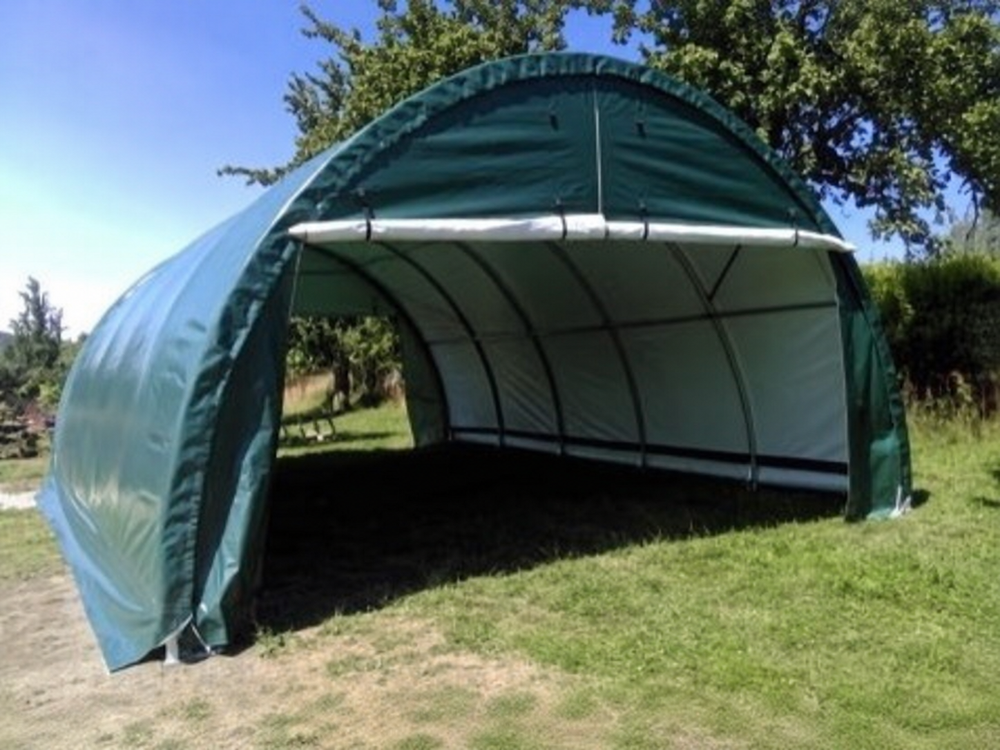
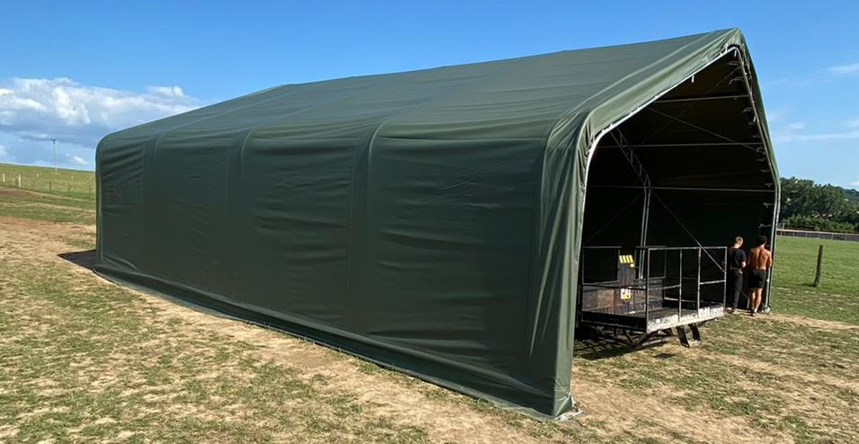
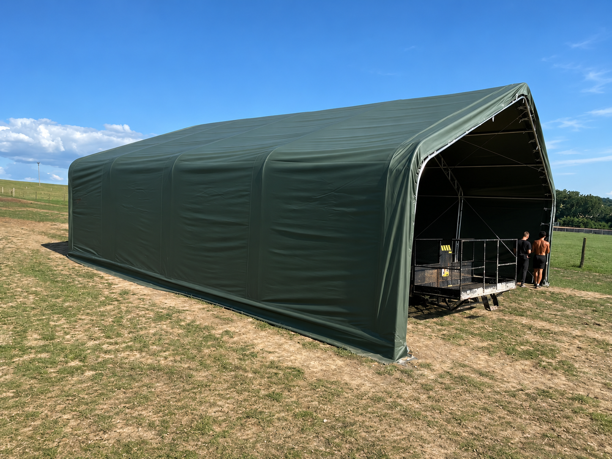
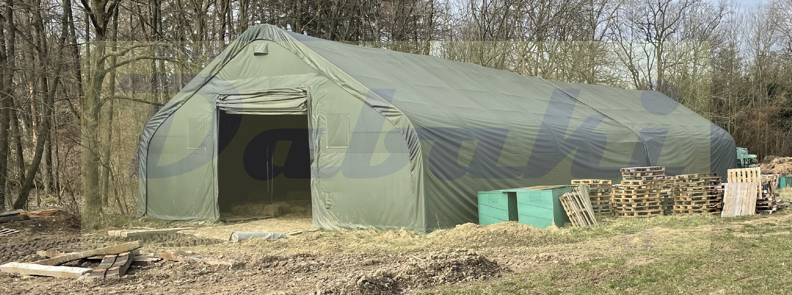
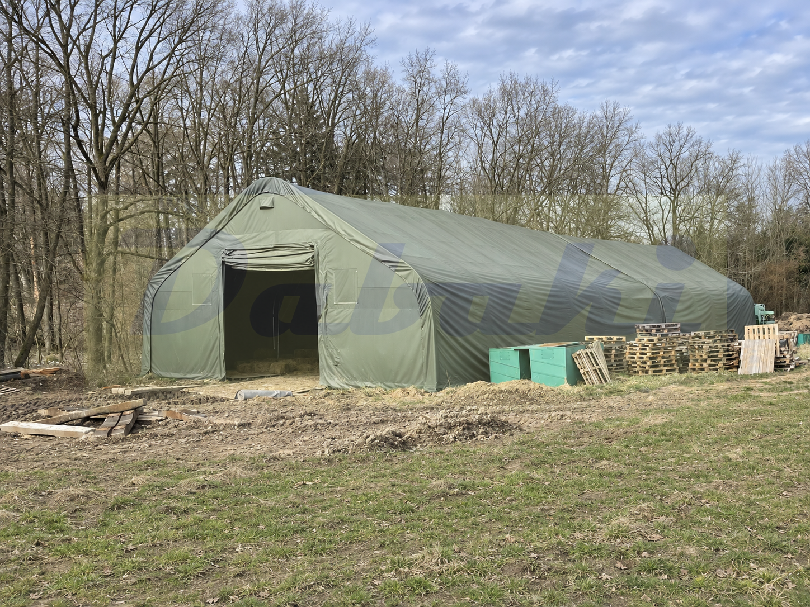
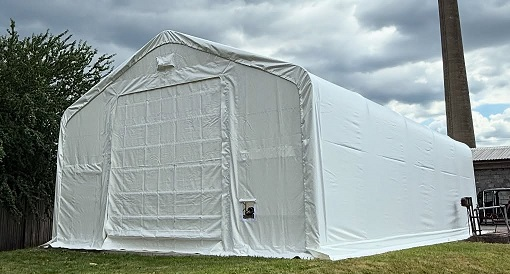
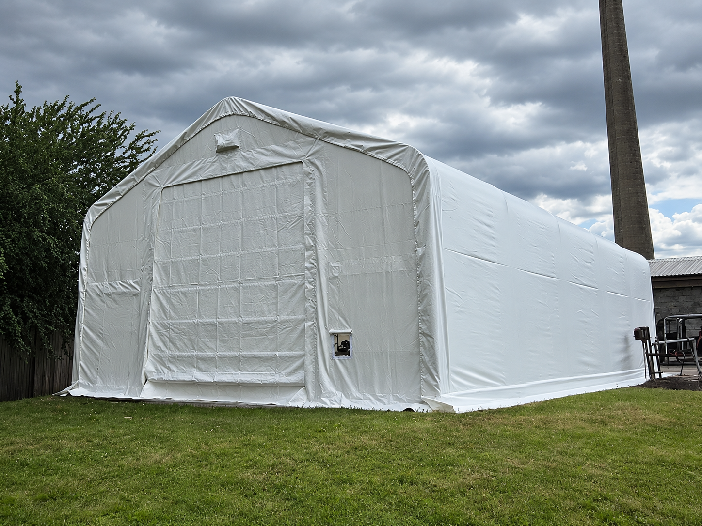

# Pilot cover fotografií – 17. 11. 2026

Čtyři návrhy byly vytvořeny vestavěným nástrojem image_gen. Všechny mají ověřený rozměr **1448 × 1086 px (přesně 4 : 3)** a obraz až po okraj. Slouží k posouzení kompozice; **následně byly uživatelem schváleny a nasazeny 17. 11. 2026**. Původní fotografie jsou přiloženy. Přesná zadání všech pěti pokusů jsou v [prompts.json](prompts.json).

| Produkt | Původní fotografie | Pilot |
| --- | --- | --- |
| Garáž pro auto, 710 |  |  |
| Dvojitá konstrukce, 152 |  |  |
| Řada 33, 50 |  |  |
| Řada 23, 233 |  |  |

## Původní kontrola věrnosti před schválením

- **Garáž:** prostý středový ořez by ohrozil levý okraj plachty, proto se pilot změnil na mírné rozšíření nahoře/dole. První pokus příliš doostřil a změnil detaily vstupu; byl vyřazen. Druhý pokus lépe zachoval měkkost zdroje, ale ani u něj nelze tvrdit totožnost původních pixelů a detailů konstrukce.
- **Dvojitá konstrukce:** nové okolí vyplňuje formát a hlavní obrys odpovídá záběru. Dochází však k rekonstrukci textury plachty a detailů otevřeného vjezdu. Nejde o pouhé doplnění okrajů původního souboru.
- **Řada 33:** rozšíření lesa a terénu funguje kompozičně. Vodoznak zůstal přítomen, ale je znovu vykreslen stejně jako jemné detaily haly a okolí. To nesplňuje požadavek přesného zachování původního záběru.
- **Řada 23:** 510 × 274 px nestačí na věrohodné doplnění drobných technických detailů. Výstup je ostřejší, ale nové detaily textury, větracího otvoru a mechanismu u vrat nejsou doložené originálem. Nezaměňovat generovanou ostrost za skutečné rozlišení.

Vizuální kontrola proběhla proti čtyřem původním souborům. Nebyla provedena pixelová registrace ani překryv; nelze deklarovat pixelově identický výrobek. Pilot nebyl nahrán do Shoptetu a neproběhla kontrola nasazených produktových karet.

## Výsledek pilotu a další postup

Pilot potvrzuje vhodnost formátu 4 : 3 a rozšíření prostředí místo velkého ořezu. Současně ukázal, že samotné textové zadání vestavěnému generátoru nezaručuje uzamčení původní fotografie. Pro ostré podklady doporučujeme přesnou kompozici: původní fotografii ponechat jako chráněnou vrstvu a z AI výsledku použít pouze nové okolí mimo její hranice. Přechody upravovat pouze v pozadí. Tato kompozice v pilotu **zatím provedena nebyla**.

U řady 23 dál hledat kvalitnější skutečný originál; aktuální pilot není náhradou chybějícího fotografického detailu. Teprve po opravě věrnosti vyrobit finální soubory a otestovat karty na telefonu i počítači podle [auditu](../../../../docs/plachtovehaly/vzhled/audit-cover-fotografii-2026-11-17.md).

## Následné schválení a nasazení

Uživatel po ukázkách detailů změny schválil. Čtyři pilotní výstupy jsou součástí deseti nasazených coverů. Předchozí výhrady dokumentují původní posouzení; aktuální stav, logo pravidla a ověření jsou v [návodu fotografií](../../../../docs/plachtovehaly/vzhled/nahledove-fotografie.md).
